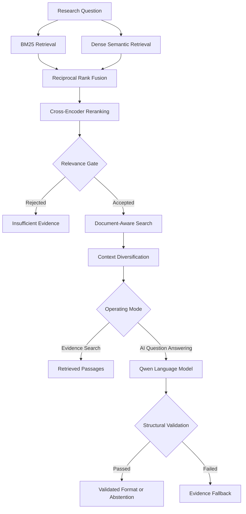
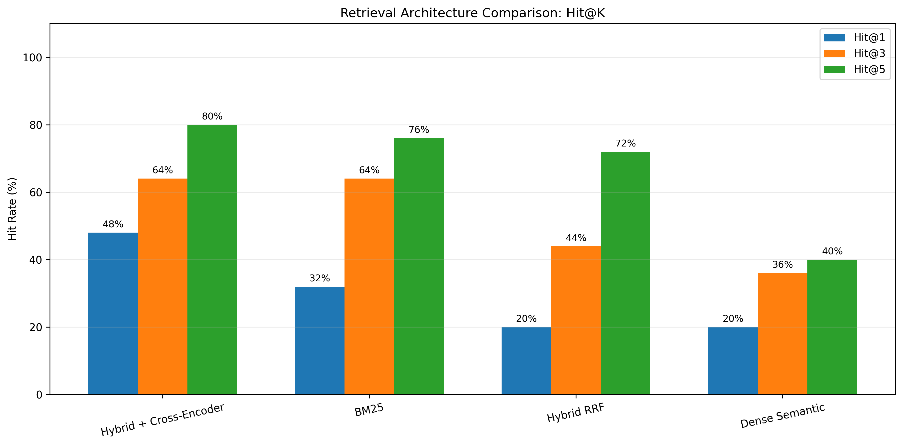
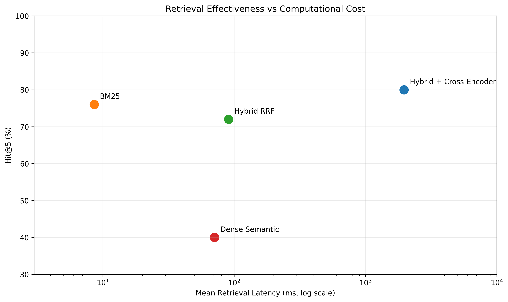
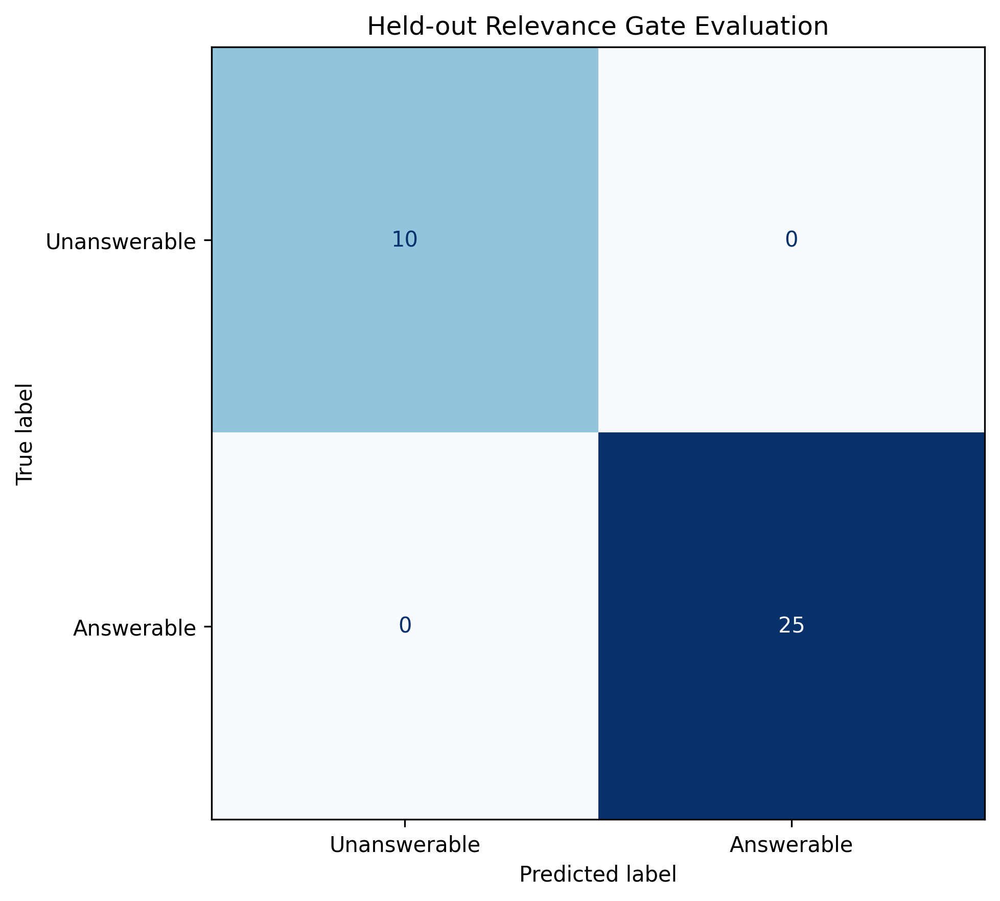
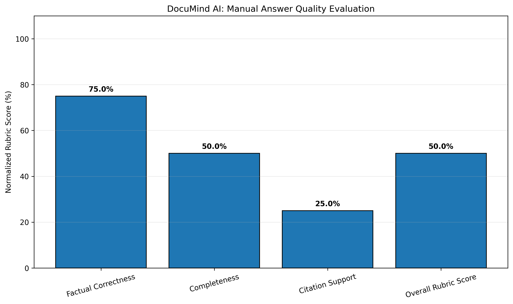

# DocuMind AI

### A Retrieval-Augmented Generation Framework for Intelligent Document Understanding and Question Answering

## Abstract

DocuMind AI is a research-oriented Retrieval-Augmented
Generation (RAG) framework designed to investigate
document retrieval, evidence-grounded question answering,
relevance-based abstention and citation-aware output
validation.

The framework integrates sparse lexical retrieval,
dense semantic retrieval, Reciprocal Rank Fusion,
cross-encoder reranking and document-aware context
selection.

A lightweight instruction-tuned language model generates
answers using retrieved evidence. Structural validation
and evidence fallback mechanisms provide alternative
outputs when generated responses fail selected citation
and formatting requirements.

The system was developed and evaluated using CPU-based
computational resources.

## Key Features

- Layout-aware PDF extraction
- Token-aware document chunking
- Dense semantic retrieval using FAISS
- Sparse lexical retrieval using BM25
- Hybrid retrieval using Reciprocal Rank Fusion
- Cross-encoder reranking
- Document-aware evidence selection
- Bibliography penalties
- Context diversification
- Relevance-based abstention
- Evidence-grounded answer generation
- Citation identifier validation
- Evidence fallback mechanisms
- Interactive Gradio interface
- Comparative retrieval benchmarking
- Statistical significance analysis
- Standalone functional testing

## System Architecture

Structural validation does not establish semantic
correctness or factual accuracy.

## Experimental Corpus

| Property | Value |
|---|---:|
| Research papers | 5 |
| PDF pages | 74 |
| Indexed passages | 433 |
| Embedding dimensions | 384 |
| Maximum content chunk size | 220 tokens |
| Chunk overlap | 44 tokens |
| Corpus version | 2 |
| Pipeline version | 5 |

### Indexed Research Papers

1. [Attention Is All You Need](https://arxiv.org/abs/1706.03762)
2. [BERT](https://arxiv.org/abs/1810.04805)
3. [Sentence-BERT](https://arxiv.org/abs/1908.10084)
4. [Retrieval-Augmented Generation](https://arxiv.org/abs/2005.11401)
5. [Dense Passage Retrieval](https://arxiv.org/abs/2004.04906)

Original PDFs and generated vector indexes are excluded
from the public repository.

## Technology Stack

| Component | Technology |
|---|---|
| Programming | Python |
| Deep learning | PyTorch |
| PDF processing | PyMuPDF, PyMuPDF4LLM |
| Embedding model | all-MiniLM-L6-v2 |
| Vector search | FAISS |
| Sparse retrieval | BM25 |
| Rank fusion | Reciprocal Rank Fusion |
| Reranker | ms-marco-MiniLM-L-6-v2 |
| Language model | Qwen2.5-1.5B-Instruct |
| Data analysis | NumPy, Pandas, SciPy |
| Visualization | Matplotlib |
| User interface | Gradio |

## Research Evaluation

### Retrieval Performance

The formal retrieval benchmark consists of 25
answerable questions with non-exhaustive,
AI-assisted relevance annotations.

| Retrieval Method | Hit@1 | Hit@3 | Hit@5 | MRR@5 |
|---|---:|---:|---:|---:|
| BM25 | 32% | 64% | 76% | 0.4747 |
| Dense Semantic | 20% | 36% | 40% | 0.2767 |
| Hybrid RRF | 20% | 44% | 72% | 0.3727 |
| Hybrid + Cross-Encoder | 48% | 64% | 80% | 0.5893 |

### Mean Retrieval Latency

| Retrieval Method | Mean Latency |
|---|---:|
| BM25 | 8.59 ms |
| Dense Semantic | 70.92 ms |
| Hybrid RRF | 90.72 ms |
| Hybrid + Cross-Encoder | 1969.02 ms |

Cross-encoder reranking improved retrieval performance
at the expense of computational latency.

### Statistical Analysis

Paired exact McNemar tests with Holm correction
were used for exploratory Hit@5 comparisons.

| Comparison | Adjusted p-value |
|---|---:|
| Cross-Encoder vs Dense | 0.005859 |
| Cross-Encoder vs BM25 | 1.000 |
| Cross-Encoder vs Hybrid RRF | 1.000 |

Only the comparison against dense retrieval was
statistically significant in this benchmark.

The small constructed benchmark limits the
generalizability of these findings.

### Relevance-Gate Evaluation

The held-out relevance-gate benchmark contained
25 answerable and 10 presumed unanswerable questions.

| Metric | Result |
|---|---:|
| True positives | 25 |
| True negatives | 10 |
| False positives | 0 |
| False negatives | 0 |
| Benchmark accuracy | 100% |

A subsequent standalone diagnostic identified a
relevance-gate false acceptance involving a GPT-4
parameter-count question.

The language model subsequently abstained correctly.

The benchmark result does not establish universal
abstention reliability.

### Baseline Answer Generation

A purposively selected diagnostic subset was
evaluated using an AI-assisted scoring rubric.

| Evaluation Dimension | Normalized Rubric Score |
|---|---:|
| Correctness | 75% |
| Completeness | 50% |
| Citation Support | 25% |
| Overall | 50% |

These scores are not general question-answering
accuracy measurements.

Independent human assessment remains pending.

### Pipeline V5

Pipeline V5 introduces document-aware retrieval,
bibliography penalties, context diversification,
structural validation and evidence fallback.

Standalone functional testing verified retrieval,
model execution, abstention and fallback behavior.

Independent full-benchmark V5 answer-quality
evaluation remains pending.

## Application

DocuMind AI provides two operating modes.

### Evidence Search

Returns retrieved research passages with document
titles and PDF page references without language
model generation.

### AI Question Answering

Generates an answer using retrieved context and
applies structural citation validation.

If the generated response fails validation,
the retrieved evidence is displayed instead.

## Installation and Usage

### Prerequisites

- Python environment compatible with the recorded dependencies
- Internet access for downloading papers and pretrained models
- Sufficient RAM and disk space for model inference
- CPU execution is supported

### Step 1: Install Dependencies

From the repository root:

    python -m pip install -r requirements.txt --extra-index-url https://download.pytorch.org/whl/cpu

The requirements file records the experimental environment.
Fresh-environment installation has not yet been fully verified.

### Step 2: Download Research Papers

    python scripts/download_papers.py --root .

### Step 3: Construct the Retrieval Index

    python scripts/build_index.py --root .

### Step 4: Launch the Application

    python app.py --root .

For an optional temporary Gradio sharing link:

    python app.py --root . --share

### Reproducibility Notes

The standalone application was successfully tested using
the original indexed corpus and existing Colab environment.

The complete installation and index reconstruction workflow
has not yet been independently verified in a fresh environment.

The corpus manifest records the SHA-256 fingerprints of
the original experimental PDFs. Newly downloaded revisions
may differ from those used in the experiments.

See docs/environment_info.json and
docs/requirements_experimental.txt for environment details.

## Repository Structure

- src/ - Core retrieval and generation modules
- scripts/ - Paper acquisition and index construction
- tests/ - Automated functional and safeguard tests
- data/evaluation/ - Frozen evaluation benchmarks
- results/ - Experimental results
- figures/ - Research visualizations
- docs/ - Configuration and research documentation
- app.py - Standalone Gradio application
- requirements.txt - Recorded software dependencies
- README.md - Project overview

## Reproducibility Status

Standalone execution was verified using the
original indexed corpus and existing Colab
software environment.

The repository includes corpus fingerprints,
environment information, evaluation configurations,
benchmark artifacts and functional test scripts.

Fresh-install reproducibility has not yet been
verified.

## Limitations

- Small experimental corpus
- Non-exhaustive relevance annotations
- AI-assisted evaluation without independent review
- Residual PDF extraction artifacts
- CPU-based inference latency
- Inconsistent generated citations
- Relevance-gate false acceptance
- No automatic semantic citation verification
- Independent V5 evaluation pending

See [Research Limitations](docs/LIMITATIONS.md).

## Future Research

- Larger document collections
- Independent human evaluation
- Improved PDF extraction
- Semantic citation verification
- Better calibrated relevance gating
- Stronger instruction-following models
- Automated reproducibility testing

## Author

**Krutarth Valera**

Research interests: Artificial Intelligence,
Machine Learning, Natural Language Processing,
Information Retrieval and Retrieval-Augmented Generation.

## Research Status

This project is an experimental research prototype,
not a production-ready question-answering system.

The reported results are limited to the described
experimental corpus and evaluation methodology.

## License

The original source code of DocuMind AI is released
under the [MIT License](LICENSE).

Third-party research papers, pretrained models,
datasets and software dependencies remain subject
to their respective licenses and usage conditions.

## Dependency Verification

All 16 specified dependencies were successfully resolved
using pip's dry-run installation mechanism, including
the CPU-specific PyTorch package.

No dependency resolution conflicts were reported.

Actual installation and end-to-end execution in a
fresh environment remain unverified.

See [Dependency Validation](docs/dependency_validation.json).
